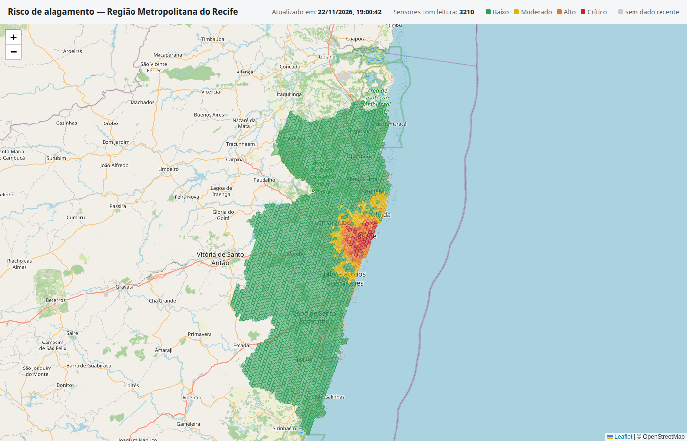
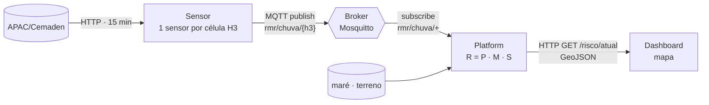
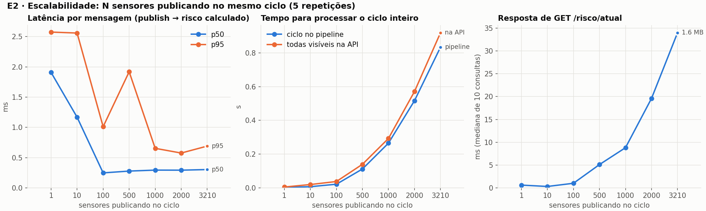

# Sensor virtual de alagamento: Região Metropolitana do Recife

IN1061 · Projeto de IoT

Solução IoT que estima, a cada 15 minutos, o risco de alagamento em cada
célula hexagonal H3 (~0,74 km²) dos 14 municípios da RMR: 3.210 sensores
virtuais de chuva.

- O **Sensor** lê a chuva real dos pluviômetros (feed público da
  APAC/Cemaden) e cada célula publica a sua leitura via **MQTT**.
- A **Platform** assina essas leituras, cruza com maré (tábua da DHN) e
  terreno (elevação, declividade, distância a rio) e calcula o risco
  `R = P · M · S`: nível 0–3, probabilidade e confiança.
- O **Dashboard** mostra o risco num mapa da RMR, célula por célula.





Arquitetura e escolhas (conectividade, paradigma, protocolo):
[`docs/arquitetura.md`](docs/arquitetura.md). Testes e resultados:
[`docs/testes.md`](docs/testes.md).

## Tecnologias

| camada | tecnologia | por quê |
|---|---|---|
| linguagem / runtime | **C# / .NET 10** | um só ecossistema pros 3 processos e pros testes |
| Sensor | .NET Worker Service (`BackgroundService`) | serviço de longa duração com ciclo de leitura |
| comunicação Sensor → Platform | **MQTT 5**, broker **Eclipse Mosquitto 2** (Docker), cliente **MQTTnet 5** | publish/subscribe, QoS 1, *retain* repovoa a Platform ao reiniciar |
| Platform | ASP.NET Core Minimal API | expõe o risco em HTTP |
| formato da API | **GeoJSON** (RFC 7946) | o mapa consome direto |
| grade espacial | **H3** (Uber), resolução 8, lib `H3Lib` | células de área igual, vizinhança uniforme |
| Dashboard | HTML + **Leaflet** + OpenStreetMap | mapa leve, sem build de front-end |
| testes | **xUnit**, `WebApplicationFactory`, `MQTTnet.Server` (broker em memória) | testa o fluxo inteiro sem Docker |
| dados | APAC/Cemaden (chuva, tempo real); DHN (maré 2026); IBGE (municípios); Open-Elevation e OSM (terreno) | ver `*/Data/` |

## Estrutura de pastas

```
iot-virtual-sensor/
├── VirtualSensor.slnx          # solução: dotnet build / dotnet test
├── docker-compose.yml          # broker MQTT (Mosquitto)
├── mosquitto.conf
├── Shared/                     # código comum a Sensor e Platform
│   ├── LeituraMqtt.cs          #   contrato MQTT: tópico por célula + payload JSON
│   ├── Grid/H3GridBuilder.cs   #   grade H3 dos 14 municípios
│   └── Data/                   #   polígonos dos municípios (IBGE)
├── Sensor/                     # dispositivo IoT virtual (Worker Service)
│   ├── Worker.cs               #   ciclo: lê chuva → publica 1 msg por célula
│   └── Sensing/                #   cliente APAC/Cemaden, estação → célula, simulador
├── Platform/                   # plataforma IoT (Web API)
│   ├── RiscoIngestorService.cs #   assina o MQTT e recalcula a célula a cada leitura
│   ├── Program.cs              #   GET /risco/atual (GeoJSON)
│   ├── Processing/             #   chuva acumulada, maré, terreno, risco
│   └── Data/                   #   maré DHN 2026, elevação, hidrografia
├── Dashboard/                  # servidor estático + mapa (wwwroot/index.html)
├── Tests/                      # testes xUnit (unidade + integração ponta a ponta)
├── Experimentos/               # testes experimentais contra o sistema rodando
├── scripts/                    # experimentos.sh, resiliencia.sh, graficos.py
└── docs/                       # arquitetura, testes, imagens
    └── resultados/             #   CSVs brutos, resumos e gráficos dos experimentos
```

## Como rodar

Pré-requisitos: [.NET 10 SDK](https://dotnet.microsoft.com/download) e
Docker (com Docker Compose). Testado em Linux.

```bash
git clone https://github.com/Vituriano/iot-virtual-sensor.git
cd iot-virtual-sensor
dotnet build
```

Cada comando abaixo num terminal próprio, a partir da raiz do repositório.

1. Subir o broker MQTT:

   ```bash
   docker compose up -d
   ```

2. Subir a Platform (API em `http://localhost:5128`):

   ```bash
   dotnet run --project Platform
   ```

3. Subir o Dashboard e abrir `http://localhost:5200`:

   ```bash
   dotnet run --project Dashboard
   ```

4. Subir o Sensor. Escolha um:

   ```bash
   dotnet run --project Sensor                     # chuva real, ciclo a cada 15 min
   dotnet run --project Sensor -- --once           # chuva real, um ciclo só
   dotnet run --project Sensor -- --simular --Sensor:IntervaloSegundos=5   # tempestade simulada
   ```

   Sem chuva forte no dia, o modo real mostra só as ~36 células com
   pluviômetro, todas em nível 0. O modo `--simular` usa a mesma
   publicação MQTT, só troca a fonte: em ~20 s o mapa mostra os 4 níveis.

O mapa atualiza a cada 30 s. Clicar numa célula mostra município, nível,
probabilidade, confiança, chuva da última hora e os fatores P, M e S.

Conferir a API direto:

```bash
curl http://localhost:5128/risco/atual
```

Resposta: um GeoJSON `FeatureCollection` (com `atualizado_em` e
`total_celulas`), uma `Feature` Polygon por célula com leitura. Nas
`properties`: município, nível (0–3), probabilidade, confiança, fatores
P/M/S, chuva da última hora, `ultima_leitura` (instante da leitura no
sensor) e `processado_em` (instante em que a Platform calculou o risco).
Antes da primeira leitura, responde `503`.

### Testes

```bash
dotnet test
```

Roda os testes automatizados, incluindo o fluxo ponta a ponta (broker
MQTT em memória + Platform completa). Não precisa de Docker.

Testes experimentais, cada um com um comando (pare a Platform antes; eles
sobem um ambiente limpo):

```bash
./scripts/experimentos.sh   # latência, escalabilidade, modelo, confiança, estabilidade (~4 min)
./scripts/resiliencia.sh    # queda e volta da Platform e do broker (~1 min)
```

Dados brutos (CSV), resumo e gráficos ficam em
[`docs/resultados/`](docs/resultados/); a análise está em
[`docs/testes.md`](docs/testes.md).

## Resultados em uma linha

Cada leitura passa pelo pipeline MQTT em **~1 ms**. Um ciclo com as
**3.210 células** é processado em **< 1 s**, com latência estável de 1 a
3.210 sensores e ao longo de 20 ciclos seguidos. Platform e broker voltam
de um reinício em **~5 s** sem perder leituras. Gráficos e análise em
[`docs/testes.md`](docs/testes.md).



## Configuração

| onde | chave | padrão |
|---|---|---|
| `Sensor/appsettings.json` | `Mqtt:Host`, `Mqtt:Port` | `localhost`, `1883` |
| `Sensor` (linha de comando) | `Sensor:IntervaloSegundos` | `900` (15 min) |
| `Platform/appsettings.json` | `Mqtt:Host`, `Mqtt:Port`, `Cors:Origins` | `localhost`, `1883`, `http://localhost:5200` |
| `Platform` | `Estado:HistoricoPath` | `Platform/estado/chuva_historico.jsonl` |
| `Dashboard/appsettings.json` | `PlatformUrl` | `http://localhost:5128` |
