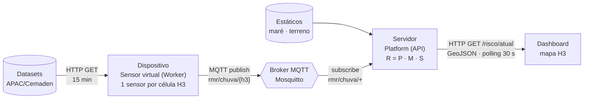

# Arquitetura — Sensor virtual de alagamento (RMR)

IN1061 · Entrega 2 · Equipe: _(preencher)_

**Visão geral.** Cada célula H3 (~0,74 km², 3.210 na RMR) é um sensor virtual de chuva. Uma plataforma IoT cruza a leitura com maré, terreno e histórico e estima o risco de alagamento (nível 0–3, probabilidade, confiança). Um dashboard mostra o resultado em mapa.

**Fluxo.** (1) A cada 15 min o Sensor lê o feed APAC/Cemaden e atribui cada estação à célula que a contém. (2) Cada sensor publica a sua leitura `{ts, chuva_mm}` no próprio tópico, com QoS 1 e *retain*. (3) A Platform assina todos os tópicos e, a cada leitura, recalcula só aquela célula: acumula a chuva (15 min/1 h/3 h), aplica maré (M) e terreno (S) e guarda o resultado em cache. (4) O Dashboard consulta a Platform, que responde um GeoJSON com o polígono e o risco de cada célula, e colore cada célula pelo nível; clicar mostra os fatores. Os sensores são independentes: não há ciclo global, e uma célula sem leitura nova mantém o último risco com confiança decrescente (alta até 20 min, média até 1 h, depois "sem dado recente", esmaecida no mapa).

| Item | Definição |
|---|---|
| Conectividade | **Wi-Fi** (IEEE 802.11), TCP/IP: dispositivo → broker → servidor |
| Paradigma | **Publish/Subscribe**, orientado a eventos (Sensor → Platform); Request/Response (Platform → Dashboard) |
| Protocolo | **MQTT 3.1.1** (TCP 1883, Mosquitto) entre Sensor e Platform; **HTTP + GeoJSON** (RFC 7946) para a tela |
| Componentes | 3 projetos .NET 10 independentes: `Sensor`, `Platform`, `Dashboard` |

**Por que MQTT.** Cada sensor é um produtor de eventos: pub/sub desacopla produtor e consumidor, o *retain* repovoa a Platform ao reiniciar e o cabeçalho é mínimo. CoAP tem pouco suporte em .NET; HTTP faria o Sensor depender do endereço da Platform. **Limites assumidos:** broker é ponto único de falha e roda sem autenticação/TLS (apenas desenvolvimento); tela usa polling, e push (SSE/WebSocket) fica como evolução. **Próxima etapa:** histórico de risco com controle de tempo no mapa (hoje só o último valor é guardado), calibração contra ocorrências reais e Eclipse Ditto (uma *Thing* por célula) no lugar do cache em memória.
