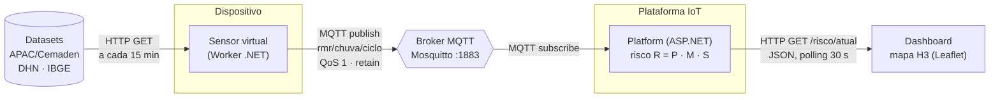

# Documento de Arquitetura — Sensor virtual de alagamento (RMR)

IN1061 · Entrega 2 · Equipe: _(preencher)_

## Visão geral

O sistema estima o risco de alagamento em cada célula H3 (~0,74 km²) dos 14 municípios da Região Metropolitana do Recife. Cada célula com estação pluviométrica funciona como um sensor virtual: lê a chuva do feed público APAC/Cemaden e publica o valor bruto. Uma plataforma IoT cruza essa leitura com maré (tábua DHN), terreno (elevação, declividade, hidrografia) e histórico acumulado para calcular o risco, que um dashboard mostra em mapa.

## Diagrama



## Fluxo de dados

1. **Aquisição.** A cada 15 min o Sensor consulta o feed APAC/Cemaden (HTTP) e associa cada estação à célula H3 que a contém (a grade tem 3.210 células; hoje cerca de 40 têm estação e, portanto, leitura).
2. **Publicação.** O Sensor publica uma mensagem JSON por ciclo no tópico `rmr/chuva/ciclo`, com QoS 1 e flag *retain*: uma Platform que (re)conecta recebe o último ciclo imediatamente. Nenhuma classificação de risco acontece aqui.
3. **Processamento.** A Platform assina o tópico, acumula a chuva (15 min/1 h/3 h), aplica o fator de maré (M) e a suscetibilidade do terreno (S), calcula `R = P · M · S` e classifica em 4 níveis (0–3), com probabilidade e confiança. O resultado fica em cache em memória.
4. **Visualização.** O Dashboard consulta `GET /risco/atual` a cada 30 s e pinta cada célula pela cor do nível, com detalhes ao clicar.

Sensor e Platform são processos independentes que só se comunicam pelo broker; se um cai, o outro continua (a Platform serve o último risco válido).

## Definição tecnológica

| Item | Decisão |
|---|---|
| Modelo de conectividade | **Wi-Fi** (IEEE 802.11), padrão da disciplina; TCP/IP sobre a rede local, dispositivo → broker → servidor |
| Paradigma de comunicação | **Publish/Subscribe, orientado a eventos** entre Sensor e Platform |
| Protocolo de aplicação | **MQTT 3.1.1** sobre TCP (porta 1883), broker Eclipse Mosquitto, QoS 1 |
| Dashboard ← Platform | HTTP Request/Response (REST/JSON), pois a tela só consulta o estado atual |
| Implementação | .NET 10, MQTTnet 5, Leaflet + h3-js |

**Por que MQTT e não HTTP/CoAP entre Sensor e Platform?** O sensor gera um evento por ciclo e pode haver vários consumidores; Pub/Sub desacopla produtor e consumidor (nenhum precisa conhecer o endereço do outro), o *retain* cobre reconexões e o cabeçalho é mínimo. CoAP (UDP) tem pouco suporte no ecossistema .NET e HTTP exigiria que o Sensor conhecesse a Platform. Limitação assumida: o broker é um ponto único de falha e a versão atual roda sem autenticação/TLS (ambiente de desenvolvimento).

## Como executar

```bash
docker compose up -d                 # broker MQTT
dotnet run --project Platform        # API + dashboard em http://localhost:5128
dotnet run --project Sensor -- --once
```
