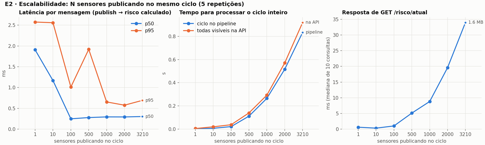
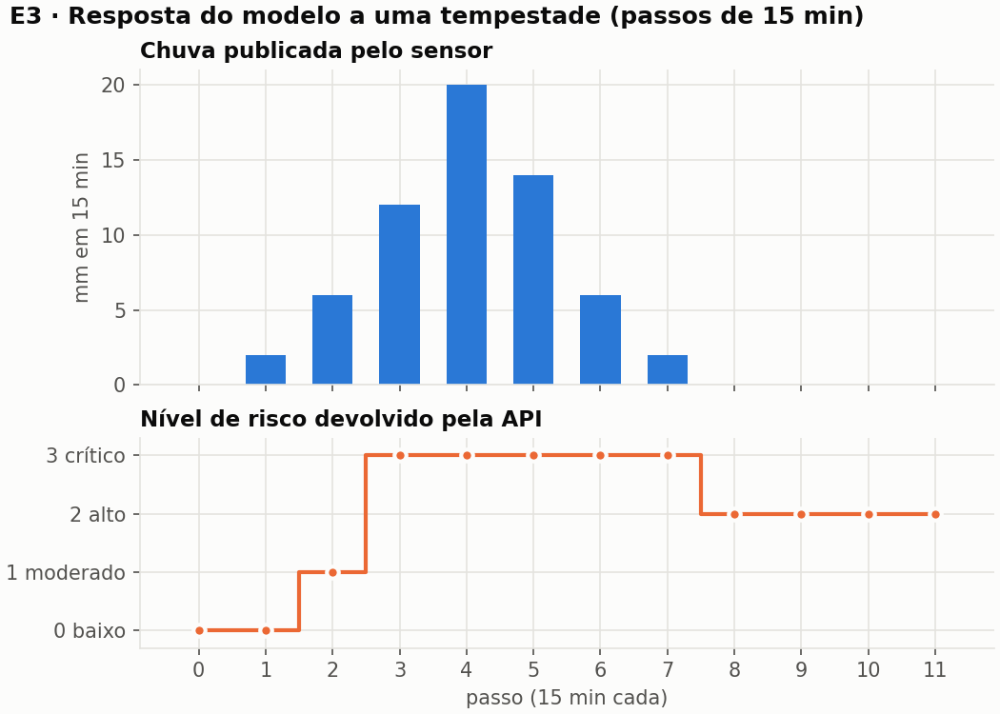
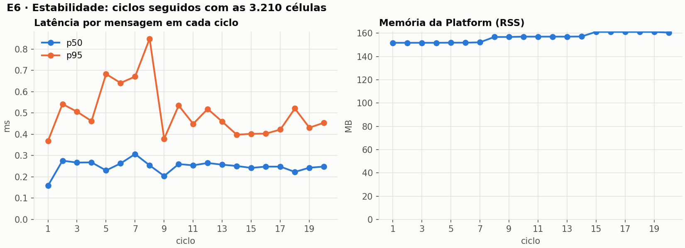

# Testes — Sensor virtual de alagamento (RMR)

IN1061 · Entrega 3

Dois tipos de teste, os dois rodam a solução de verdade:

1. **Testes automatizados** (`Tests/`, xUnit): unidade e integração ponta
   a ponta. Rodam com `dotnet test`, sem Docker.
2. **Testes experimentais** (`Experimentos/` e `scripts/`): medem o sistema
   rodando com o broker Mosquitto real, a Platform e o Sensor. Cada script
   sobe um ambiente limpo e grava dados brutos (CSV), resumo e gráficos em
   [`resultados/`](resultados/).

Ambiente das medições: notebook Linux (Ubuntu), 16 núcleos, .NET 10, tudo
em `localhost`, 22/11/2026.

## 1. Testes automatizados

```bash
dotnet test
```

| grupo | o que garante |
|---|---|
| `Unit/ContratoMqttTests` | tópico `rmr/chuva/{h3}` e payload `{ts, chuva_mm}` fazem ida e volta sem perda |
| `Unit/RiskCalculatorTests` | cortes dos níveis 0–3, `R = P · M · S`, probabilidade entre 0 e 1 e monotônica, confiança por idade |
| `Unit/RainHistoryStoreTests` | acumulados 15 min / 1 h / 3 h, leitura repetida não soma duas vezes, histórico sobrevive a reinício, leitura fora de ordem |
| `Unit/SensorTests` | grade com 3.210 células e 14 municípios, estação → célula (máximo), estação fora da RMR ignorada, maré bate com a tábua da DHN e vira fator neutro fora de 2026, tempestade simulada |
| `Integracao/FluxoPontaAPontaTests` | **fluxo inteiro**: broker MQTT real (MQTTnet.Server) + Platform completa (`WebApplicationFactory`) + cliente publicando como o Sensor + `GET /risco/atual` como o Dashboard |

Os testes de integração cobrem: API responde 503 antes da primeira
leitura; leitura publicada aparece no GeoJSON com polígono, município,
nível, confiança e `processado_em`; sensores independentes; leitura de 2 h
atrás vira "sem dado recente"; mensagem inválida não derruba a ingestão;
Platform que sobe depois recupera o estado pelas mensagens retidas.

```
Passed!  - Failed: 0, Passed: 38, Skipped: 0, Total: 38
```

## 2. Testes experimentais

```bash
./scripts/experimentos.sh   # E1–E4 e E6 (~4 min)
./scripts/resiliencia.sh    # E5 (~1 min)
```

Como cada medida é tomada:

- O programa `Experimentos` faz o papel do Sensor: publica no broker do
  mesmo jeito que o Worker (em sequência, QoS 1). Também faz o papel do
  Dashboard: consulta `GET /risco/atual`.
- **Latência por mensagem** = do `ts` da leitura (pego logo antes do
  publish) até `processado_em` (quando a Platform calculou o risco). Os
  dois relógios são o mesmo, porque tudo roda na mesma máquina. Essa
  medida isola o pipeline do custo de consultar a API.
- **Visível na API** = do primeiro publish até a API devolver a leitura.
  É o que um cliente consultando sem parar enxerga.

### E0 · Fluxo real com o feed da APAC/Cemaden

`dotnet run --project Sensor -- --once` com o broker e a Platform no ar.

| métrica | valor |
|---|---|
| registros do feed dentro da RMR | ~720 |
| células (sensores) com leitura | 36 de 3.210 |
| municípios cobertos | 11 de 14 |
| duração do ciclo (HTTP + publicação) | ~2 s |

No dia do teste não choveu forte na RMR: as 36 células ficaram em nível 0.
O mapa mostra só as células com pluviômetro:


### Tempestade simulada

Para testar os níveis altos sem depender de chuva, o Sensor tem o modo
`--simular`. Ele troca só a fonte de dado: grade, MQTT, tópico e payload
são os mesmos. Um núcleo de chuva centrado no Recife cresce até 20 mm por
ciclo e depois dissipa.

```bash
dotnet run --project Sensor -- --simular --Sensor:IntervaloSegundos=5
```


### E1 · Latência de uma leitura, com as 3.210 células ativas

30 leituras, uma por vez, com a Platform já servindo o mapa inteiro (a
situação normal de operação).

| medida | p50 | p95 | máx |
|---|---|---|---|
| publish → risco calculado na Platform | 1,2 ms | 1,8 ms | 1,9 ms |
| publish → visível em `GET /risco/atual` | 60 ms | 126 ms | 139 ms |

O pipeline MQTT leva cerca de 1 ms. Quase toda a espera de quem consulta é
o tempo de baixar e ler a resposta da API cheia (1,6 MB). Para o usuário,
o que domina é o polling de 30 s do Dashboard.

### E2 · Escalabilidade: de 1 a 3.210 sensores no mesmo ciclo

Mesma ideia do repositório de referência da disciplina (RTT × número de
clientes): variar a carga e medir. São 7 tamanhos, 5 repetições cada,
34.105 mensagens no total.



| sensores | latência p50 | latência p95 | ciclo no pipeline | visível na API | vazão | resposta da API | tamanho da API |
|---|---|---|---|---|---|---|---|
| 1 | 1,9 ms | 2,3 ms | 1,9 ms | 4,7 ms | — | 0,6 ms | 3 KB |
| 10 | 1,2 ms | 2,3 ms | 6,9 ms | 20 ms | — | 0,3 ms | 8 KB |
| 100 | 0,2 ms | 1,0 ms | 21 ms | 37 ms | 4.677 msg/s | 1,0 ms | 51 KB |
| 500 | 0,3 ms | 1,5 ms | 112 ms | 139 ms | 4.482 msg/s | 5,1 ms | 251 KB |
| 1.000 | 0,3 ms | 0,7 ms | 265 ms | 293 ms | 3.777 msg/s | 8,8 ms | 500 KB |
| 2.000 | 0,3 ms | 0,6 ms | 516 ms | 571 ms | 3.874 msg/s | 20 ms | 1,0 MB |
| 3.210 | 0,3 ms | 0,7 ms | 833 ms | 919 ms | 3.851 msg/s | 34 ms | 1,6 MB |

O que os dados mostram:

- **A latência por mensagem não cresce com a carga.** Ela fica abaixo de
  1 ms (p95) de 100 a 3.210 sensores. Com 1 ou 10 sensores ela é um pouco
  maior, porque a conexão está "fria" e há poucas amostras.
- **O ciclo cresce de forma linear com N, e o gargalo é quem publica, não
  a Platform.** A vazão fica estável em ~3.800–4.700 msg/s, que é o ritmo
  de um publicador em sequência esperando o PUBACK de cada mensagem QoS 1.
  A Platform processa cada mensagem em menos de 1 ms, então acompanha.
- **O custo que cresce é o da API.** A resposta vai de 3 KB a 1,6 MB e de
  0,6 ms a 34 ms. Isso é linear e aceitável com 3.210 células e polling a
  cada 30 s. Para uma grade maior, o caminho seria filtrar por área visível
  ou enviar só as células que mudaram.
- **Folga:** o ciclo real é a cada 15 min, e o ciclo inteiro é processado
  em menos de 1 s.

### E3 · Resposta do modelo a uma tempestade

Uma célula do Recife recebe uma tempestade em passos de 15 min. Os valores
são os que a API devolveu.



| passo | chuva (mm) | acum. 1 h | P | M (maré) | S (terreno) | R | nível | prob. |
|---|---|---|---|---|---|---|---|---|
| 0 | 0 | 0 | 0,00 | 1,24 | 0,71 | 0,00 | 0 | 0% |
| 1 | 2 | 2 | 0,20 | 1,15 | 0,71 | 0,16 | 0 | 18% |
| 2 | 6 | 8 | 0,80 | 1,05 | 0,71 | 0,60 | 1 | 58% |
| 3 | 12 | 20 | 1,80 | 1,00 | 0,71 | 1,28 | 3 | 100% |
| 4 | 20 | 40 | 3,20 | 1,00 | 0,71 | 2,28 | 3 | 100% |
| 5 | 14 | 54 | 3,40 | 1,00 | 0,71 | 2,43 | 3 | 100% |
| 6 | 6 | 58 | 2,00 | 1,00 | 0,71 | 1,43 | 3 | 100% |
| 7 | 2 | 54 | 1,80 | 1,00 | 0,71 | 1,28 | 3 | 100% |
| 8 | 0 | 42 | 1,40 | 1,00 | 0,71 | 1,00 | 2 | 87% |
| 9 | 0 | 22 | 1,03 | 1,00 | 0,71 | 0,74 | 2 | 69% |
| 10 | 0 | 8 | 1,03 | 1,00 | 0,71 | 0,74 | 2 | 69% |
| 11 | 0 | 2 | 1,03 | 1,00 | 0,71 | 0,74 | 2 | 69% |

Como ler a tabela:

- O risco sobe junto com o acumulado de chuva e chega ao nível 3 no passo
  3. Essa célula tem terreno suscetível (S = 0,71).
- Quando a chuva para, o nível cai para 2 e fica ali enquanto o acumulado
  de 3 h ainda passa do limiar. É o efeito do solo saturado.
- A maré baixando (M de 1,24 para 1,00) reduz um pouco o risco nos
  primeiros passos.

### E4 · Confiança pela idade da leitura

| idade da leitura | confiança devolvida |
|---|---|
| 0 min | alta |
| 15 min | alta |
| 45 min | média |
| 120 min | sem dado recente |

### E5 · Resiliência

`scripts/resiliencia.sh` publica um ciclo com as 3.210 células (com
retain) e derruba as peças, uma de cada vez.

| cenário | resultado |
|---|---|
| Platform reiniciada → API de volta com as 3.210 células (retain) | 5,75 s |
| broker reiniciado → Platform reconectada e assinando | 5,20 s |
| consultas à API durante a queda do broker que falharam | 0 de 18 |
| leituras retidas após restart do broker (persistência) | 3.210 de 3.210 |

Os 5,75 s incluem a subida da Platform (carregar a grade e calcular o
terreno das 3.210 células). A reconexão ao broker é tentada a cada 5 s.

### E6 · Estabilidade ao longo do tempo

20 ciclos completos (3.210 sensores) em sequência, um a cada ~2 s. Isso dá
450 vezes o ritmo real.



| medida | resultado |
|---|---|
| latência por mensagem, p95 (pior ciclo) | 0,85 ms |
| ciclo no pipeline (mín / mediana / máx) | 489 / 680 / 853 ms |
| memória da Platform (ciclo 1 → 20) | 152 → 161 MB |

A latência não sobe com o tempo. A memória cresce 9 MB em 64 mil leituras
porque o histórico guarda as leituras das últimas 3 h 15 por célula. No
ritmo real (uma leitura a cada 15 min), isso fica limitado a 13 leituras
por célula.

## 3. Problemas que os testes encontraram (e foram corrigidos)

1. **A Platform recuperava só 1.040 de 3.210 células depois de
   reiniciar.**
   - Causa: o Mosquitto limita a fila de cada cliente a 1.000 mensagens
     (+20 em voo) e descarta o resto sem avisar. Como todas as leituras
     retidas chegam de uma vez na assinatura, 2/3 do mapa sumia.
   - Correção: `max_queued_messages 10000` em `mosquitto.conf`. Também
     ligamos `persistence`, para que um restart do broker não apague as
     leituras retidas.
2. **Uma leitura atrasada "voltava o tempo" de uma célula.**
   - Causa: com QoS 1, uma leitura antiga pode chegar depois de uma mais
     nova. A Platform calculava o risco no instante da leitura antiga e
     sobrescrevia o estado atual.
   - Correção: o acumulado passa a ser calculado sempre no instante da
     leitura mais recente da célula (`RainHistoryStore`). Há um teste
     cobrindo o caso.
3. **`--simular --Sensor:IntervaloSegundos=2` ignorava o intervalo.**
   - Causa: o parser de linha de comando do .NET lia o argumento seguinte
     como valor da flag.
   - Correção: as flags `--once` e `--simular` são retiradas antes de
     montar a configuração.
4. **A tábua de marés só cobre 2026, e a partir de 2027 toda leitura dava
   erro.**
   - Correção: fora da tábua, M passa a valer 1 (neutro), a Platform
     registra um aviso e o risco continua sendo calculado com chuva e
     terreno.

## 4. Limitações conhecidas

- Limiares e pesos do modelo ainda não foram calibrados contra ocorrências
  reais de alagamento. A probabilidade é um proxy, não uma probabilidade
  estatística.
- A tábua de marés precisa ser atualizada a cada ano (a DHN publica em
  PDF).
- O broker roda sem autenticação nem TLS (só desenvolvimento local).
- Os scripts experimentais usam bash e foram testados em Linux.
