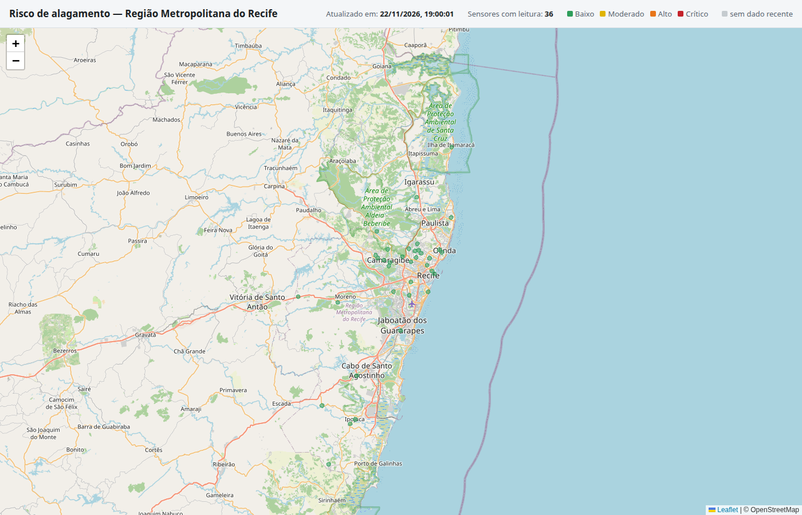
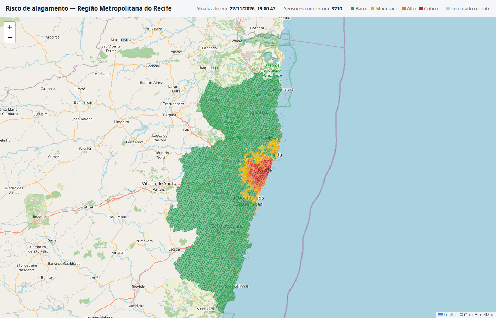

# Testes — Sensor virtual de alagamento (RMR)

IN1061 · Entrega 3

Dois tipos de teste, os dois rodam a solução de verdade:

1. **Testes automatizados** (`Tests/`, xUnit, 38 testes): unidade e
   integração ponta a ponta. Rodam com `dotnet test`, sem precisar de
   Docker.
2. **Testes experimentais** (`Experimentos/` e `scripts/resiliencia.sh`):
   medem o sistema rodando com o broker Mosquitto real, a Platform e o
   Sensor.

Resultados brutos: [`resultados/experimentos.md`](resultados/experimentos.md)
e [`resultados/resiliencia.md`](resultados/resiliencia.md). Ambiente das
medições: notebook Linux, 16 núcleos, .NET 10, tudo em `localhost`,
22/11/2026.

## 1. Testes automatizados

```bash
dotnet test
```

| grupo | o que garante |
|---|---|
| `Unit/ContratoMqttTests` | tópico `rmr/chuva/{h3}` e payload `{ts, chuva_mm}` fazem ida e volta sem perda |
| `Unit/RiskCalculatorTests` | cortes dos níveis 0–3, `R = P · M · S`, probabilidade entre 0 e 1 e monotônica, confiança por idade |
| `Unit/RainHistoryStoreTests` | acumulados 15 min / 1 h / 3 h, leitura repetida não soma duas vezes, histórico sobrevive a reinício, leitura fora de ordem |
| `Unit/SensorTests` | grade com 3.210 células e 14 municípios, estação → célula (máximo), estação fora da RMR ignorada, maré bate com a tábua da DHN, tempestade simulada |
| `Integracao/FluxoPontaAPontaTests` | **fluxo inteiro**: broker MQTT real (MQTTnet.Server) + Platform completa (`WebApplicationFactory`) + cliente publicando como o Sensor + `GET /risco/atual` como o Dashboard |

Os testes de integração cobrem: API responde 503 antes da primeira
leitura; leitura publicada aparece no GeoJSON com polígono, município,
nível e confiança; sensores independentes; leitura de 2 h atrás vira
"sem dado recente"; mensagem inválida não derruba a ingestão; Platform que
sobe depois recupera o estado pelas mensagens retidas.

```
Passed!  - Failed: 0, Passed: 38, Skipped: 0, Total: 38
```

## 2. Testes experimentais

### E0 · Fluxo real com o feed da APAC/Cemaden

`dotnet run --project Sensor -- --once` com o broker e a Platform no ar.

| métrica | valor |
|---|---|
| registros do feed dentro da RMR | 720 |
| células (sensores) com leitura | 36 de 3.210 |
| municípios cobertos | 11 de 14 |
| duração do ciclo (HTTP + publicação) | ~2 s |

No dia do teste não choveu forte na RMR: todas as 36 células ficaram em
nível 0. O mapa mostra só as células com pluviômetro:



### Tempestade simulada

Pra testar os níveis altos sem depender de chuva, o Sensor tem o modo
`--simular`: troca só a fonte de dado (o resto — grade, MQTT, tópico,
payload — é o mesmo). Um núcleo de chuva centrado no Recife cresce até
20 mm por ciclo e dissipa. Com ciclos de 2 s:

```bash
dotnet run --project Sensor -- --simular --Sensor:IntervaloSegundos=2
```

Depois de 4 ciclos: 3.210 células, 2.960 em nível 0, 122 em 1, 70 em 2 e
58 em 3.



### E1 · Latência ponta a ponta

Tempo entre o `publish` MQTT e a leitura estar visível em
`GET /risco/atual` (o que o Dashboard consulta). 30 leituras, uma por vez.

| mín | mediana | p95 | máx | média |
|---|---|---|---|---|
| 2 ms | 7 ms | 11 ms | 19 ms | 7 ms |

O que domina a latência que o usuário vê é o polling de 30 s do
Dashboard, não o pipeline.

### E2 · Carga: as 3.210 células publicando no mesmo ciclo

| métrica | valor |
|---|---|
| tempo para publicar todas (QoS 1) | 690 ms |
| tempo até todas visíveis na API | 1,04 s |
| vazão ponta a ponta | ~3.080 leituras/s |
| tamanho da resposta `GET /risco/atual` | 1,48 MB |
| tempo de resposta da API (mediana de 10) | 8 ms |

O ciclo do Sensor é de 15 min; processar um ciclo completo leva ~1 s, ou
seja, sobra folga de ~900×.

### E3 · Resposta do modelo a uma tempestade

Uma célula do Recife recebe uma tempestade em passos de 15 min. Valores
devolvidos pela API:

| passo | chuva (mm) | acum. 1 h | P | M (maré) | S (terreno) | nível | prob. |
|---|---|---|---|---|---|---|---|
| 0 | 0 | 0 | 0.00 | 1.42 | 0.33 | 0 | 0% |
| 1 | 2 | 2 | 0.20 | 1.34 | 0.33 | 0 | 10% |
| 2 | 6 | 8 | 0.80 | 1.25 | 0.33 | 1 | 36% |
| 3 | 12 | 20 | 1.80 | 1.16 | 0.33 | 1 | 65% |
| 4 | 20 | 40 | 3.20 | 1.06 | 0.33 | 2 | 94% |
| 5 | 14 | 54 | 3.40 | 1.00 | 0.33 | 2 | 94% |
| 6 | 6 | 58 | 2.00 | 1.00 | 0.33 | 1 | 63% |
| 7 | 2 | 54 | 1.80 | 1.00 | 0.33 | 1 | 57% |
| 8 | 0 | 42 | 1.40 | 1.00 | 0.33 | 1 | 46% |
| 9 | 0 | 22 | 1.03 | 1.00 | 0.33 | 1 | 36% |
| 10 | 0 | 8 | 1.03 | 1.00 | 0.33 | 1 | 36% |
| 11 | 0 | 2 | 1.03 | 1.00 | 0.33 | 1 | 36% |

Leitura: o risco sobe com o acumulado, a maré baixando (M de 1,42 → 1,00)
segura o nível, e depois que a chuva para o nível 1 permanece enquanto o
acumulado de 3 h ainda passa do limiar (solo saturado). Essa célula tem
terreno pouco suscetível (S = 0,33): a mesma chuva numa célula baixa e
perto de canal chega ao nível 3, como mostra o mapa simulado.

### E4 · Confiança pela idade da leitura

| idade da leitura | confiança devolvida |
|---|---|
| 0 min | alta |
| 15 min | alta |
| 45 min | média |
| 120 min | sem dado recente |

### E5 · Resiliência

`scripts/resiliencia.sh`: publica um ciclo com as 3.210 células e derruba
as peças, uma de cada vez.

| cenário | resultado |
|---|---|
| Platform reiniciada → API de volta com as 3.210 células (retain) | 5,75 s |
| broker reiniciado → Platform reconectada e assinando | 5,20 s |
| consultas à API durante a queda do broker que falharam | 0 de 18 |
| leituras retidas após restart do broker (persistência) | 3.210 de 3.210 |

Os 5,75 s incluem a subida da Platform (carregar a grade e calcular o
terreno das 3.210 células); a reconexão ao broker é feita a cada 5 s.

## 3. Problemas que os testes encontraram (e foram corrigidos)

1. **Platform recuperava só 1.040 de 3.210 células depois de reiniciar.**
   O Mosquitto limita a fila por cliente a 1.000 mensagens (+20 em voo) e
   descarta o resto sem avisar. Como todas as leituras retidas chegam de
   uma vez na assinatura, 2/3 do mapa sumia. Correção:
   `max_queued_messages 10000` em `mosquitto.conf`. Também ligamos
   `persistence`, pra que um restart do broker não apague as leituras
   retidas.
2. **Leitura atrasada "voltava o tempo" de uma célula.** Com QoS 1 uma
   leitura antiga pode chegar depois de uma mais nova; a Platform
   calculava o risco no instante da leitura antiga e sobrescrevia o
   estado atual. Correção: o acumulado é sempre calculado no instante da
   leitura mais recente da célula (`RainHistoryStore`), com teste
   cobrindo o caso.
3. **`--simular --Sensor:IntervaloSegundos=2` ignorava o intervalo.** O
   parser de linha de comando do .NET lia o argumento seguinte como valor
   da flag. Correção: as flags `--once`/`--simular` são retiradas antes de
   montar a configuração.

## 4. Limitações conhecidas

- A tábua de marés cobre só 2026; depois disso a Platform registra erro
  por leitura (a API segue no ar com o último risco válido).
- Limiares e pesos do modelo ainda não foram calibrados contra
  ocorrências reais de alagamento; probabilidade é um proxy, não uma
  probabilidade estatística.
- Broker sem autenticação/TLS (só desenvolvimento local).

## Como reproduzir

```bash
dotnet build
dotnet test                                   # 38 testes automatizados

docker compose up -d                          # broker
dotnet run --project Platform -- --Estado:HistoricoPath=/tmp/exp.jsonl
dotnet run --project Experimentos             # E1–E4 (outro terminal)

./scripts/resiliencia.sh                      # E5 (com a Platform parada)
```

Os experimentos E3/E4 usam células que a Platform ainda não conhece; pra
repetir, reinicie a Platform com um histórico novo.
